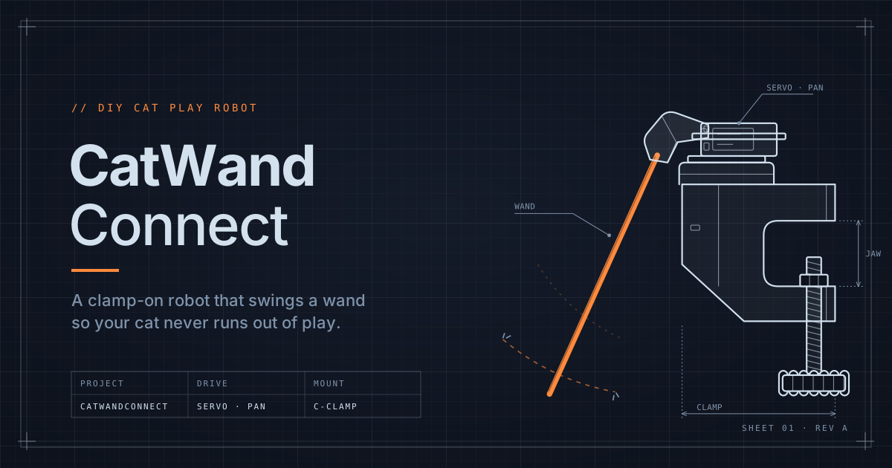

<h1 align="center">
  
</h1>

<a href="README.md">English</a> · <b>Français</b>

**Un robot open-hardware qui joue avec ton chat.** Un ESP32 agite une canne à pêche pour chat grâce à deux servos, et tu le pilotes depuis ton téléphone, sur une page web servie par le robot lui-même : pas d'appli, pas de cloud, pas de compte. Home Assistant est facultatif, et tout est ouvert : les pièces à imprimer, le firmware et la documentation.

<!-- github-only -->
> [!TIP]
> Ces guides sont plus faciles à lire sur le **[site de CatWandConnect →](https://vistorx.github.io/CatWandConnect/fr/)**.
<!-- /github-only -->

  
  

  
  
  
  

## En images

<table>
  <tr>
    <td width="34%" valign="top">

https://github.com/user-attachments/assets/914092e7-1f09-4832-85f9-01eeb9a11499

<em>CatWandConnect en 50 secondes : imprime-le, assemble-le, ajoute le jouet préféré de ton chat, joue.</em>

</td>
    <td width="22%" align="center" valign="top"> <em>Joue depuis ton téléphone</em></td>
    <td width="44%" align="center" valign="top"> <em>Home Assistant, intégration native</em>   <em>Home Assistant, connexion MQTT</em></td>
  </tr>
</table>

<!-- gallery: photo of the assembled robot -->
<!-- gallery: a cat playing with the robot -->
<!-- gallery: the electronics inside the technical cavity -->

## Ce que c'est

- **Joue depuis ton téléphone.** Un joystick et un curseur de vitesse dans n'importe quel navigateur sur ton Wi-Fi, sans appli à installer.
- **Sessions de jeu.** Choisis une durée et touche Démarrer : la baguette joue toute seule avec ton chat, dans tes limites, puis se range.
- **Sûr par conception.** Des limites de course qu'il ne dépasse jamais, un bouton Ranger que rien ne peut interrompre, des mouvements doux, et un arrêt dès que ton téléphone se déconnecte.
- **Facile à installer.** Installe-le depuis le navigateur, saisis ton Wi-Fi (ou passe cette étape et utilise le hotspot du robot), puis laisse l'assistant de calibration adapter le robot à ton montage.
- **À toi de l'adapter.** Tes broches et tes servos, le nom de ton robot, l'anglais ou le français, un code PIN facultatif et des mises à jour par Wi-Fi.
- **Home Assistant si tu veux**, avec son intégration native ou via MQTT, et une API ouverte pour tout le reste.

**[Toutes les fonctionnalités →](docs/features.fr.md)**

## Fabrique le tien

Pour le fabriquer, tu vas imprimer les pièces, câbler l'électronique, installer le logiciel, assembler le robot et, si tu veux, le connecter à Home Assistant.

### 1. Imprimer les pièces

Sept pièces, en PETG, ABS ou PLA. Seule la pince a besoin de supports. Pas d'imprimante ? N'importe quel service d'impression ou fablab peut les imprimer.

**[Guide détaillé →](docs/print.fr.md)** · **[Liste des pièces →](docs/print.fr.md#ce-quil-te-faut)**

### 2. Câbler l'électronique

<!-- photo: the wired electronics on the table -->

Un chargeur USB-C alimente tout, à travers deux petites cartes qui en font du 5 V pour les deux servos et l'ESP32. Il faut souder un peu.

**[Guide détaillé →](docs/wiring.fr.md)** · **[Liste des pièces →](docs/wiring.fr.md#ce-quil-te-faut)**

### 3. Installer le logiciel

  

Branche la carte sur un ordinateur et installe le firmware depuis Chrome ou Edge, sans rien télécharger. Les mises à jour suivantes passent par le Wi-Fi.

**[Guide détaillé →](docs/install.fr.md)** · **[Liste des pièces →](docs/bom.fr.md)**

### 4. Assembler le robot

<!-- photo or video: the assembled robot -->
Des photos et des vidéos de l'assemblage arrivent.

Les servos, l'électronique et un roulement de skateboard se montent dans les pièces imprimées, avec quelques vis M3. Le robot alimente les servos pour les mettre en position au fil du montage.

**[Guide détaillé →](docs/assembly.fr.md)** · **[Liste des pièces →](docs/assembly.fr.md#ce-quil-te-faut)**

### 5. En option : connecter à Home Assistant

Ajoute le robot à Home Assistant avec l'intégration native (HACS) ou par MQTT, avec un tableau de bord tout prêt pour chacune.

**[Guide détaillé →](docs/home-assistant.fr.md)** · **[Liste des pièces →](docs/home-assistant.fr.md#ce-quil-te-faut)**

## Documentation

- [1. Imprimer les pièces](docs/print.fr.md)
- [2. Câbler l'électronique](docs/wiring.fr.md)
- [3. Installer le logiciel](docs/install.fr.md)
- [4. Assembler le robot](docs/assembly.fr.md)
- [5. Configurer Home Assistant](docs/home-assistant.fr.md) (facultatif)
- [Liste complète des pièces](docs/bom.fr.md)
- [Fonctionnalités](docs/features.fr.md)
- [Dépannage](docs/troubleshooting.fr.md)
- [Nouveautés](CHANGELOG.md) (en anglais)
- [Obtenir de l'aide](SUPPORT.fr.md) · [Discord](https://discord.gg/Rbqge3v9dk)

<b>Contribuer</b>

Les issues et les pull requests sont les bienvenues : commence par [Bien démarrer](docs/getting-started.fr.md). On peut travailler sur l'interface sans matériel, grâce au simulateur `firmware/tools/dev_server.mjs`.

- [Bien démarrer](docs/getting-started.fr.md) : outils, compilation, tests, simulateur et organisation du code
- [API du robot](docs/api.fr.md) : API HTTP, WebSocket et MQTT, pour les scripts et les intégrations
- [Checklist de recette](docs/acceptance-checklist.fr.md) : ce qu'il faut vérifier sur le vrai robot avant chaque version
- [Publier une version](docs/releasing.md) : canaux de publication, publier une version et le flasher web (en anglais)
- [Glossaire](CONTEXT.md) · [Décisions de conception](docs/adr/) : le vocabulaire du projet, et pourquoi les choses sont comme elles sont (en anglais)
- [Spec V1](https://github.com/vistorx/CatWandConnect/issues/1) · [Spec Support](https://github.com/vistorx/CatWandConnect/issues/47) · [Prévu pour plus tard](https://github.com/vistorx/CatWandConnect/issues?q=is%3Aopen+label%3Afuture)
- [Médias](media/README.md) : logo, bannières, photos et captures d'écran, et comment en ajouter (en anglais)
- [Serveur Discord](docs/discord.fr.md) : l'organisation du serveur communautaire, pour les mainteneurs
- [AGENTS.md](AGENTS.md) : instructions pour les agents de code IA (en anglais)

## Obtenir de l'aide

- **Questions, aide au montage, montrer ton robot :** le [Discord CatWandConnect](https://discord.gg/Rbqge3v9dk). Pas besoin de compte GitHub ; le français, l'anglais et d'autres langues sont les bienvenus.
- **Un bug ?** [Ouvre une issue](https://github.com/vistorx/CatWandConnect/issues/new/choose), ou poste-le dans `#support` sur Discord.
- **Un problème de sécurité ?** Signale-le [en privé](SECURITY.md), jamais en public.

CatWandConnect est gratuit et maintenu sur du temps libre, sans délai de réponse garanti ; voir [Obtenir de l'aide](SUPPORT.fr.md) pour savoir quoi fournir. Si ton chat l'adore, tu peux soutenir le projet via [GitHub Sponsors](https://github.com/sponsors/vistorx). Des kits prêts à monter suivront peut-être.

## Licence

| | |
|---|---|
| Firmware | [GPL-3.0-or-later](LICENSES/GPL-3.0-or-later.txt) |
| Plans du matériel | [CERN-OHL-S-2.0](LICENSES/CERN-OHL-S-2.0.txt) |
| Documentation | [CC BY-SA 4.0](LICENSES/CC-BY-SA-4.0.txt) |

Tu peux fabriquer, modifier et vendre ta propre version. Voir [LICENSE.md](LICENSE.md). Le nom « CatWandConnect » est réservé au projet officiel et à ses kits ; voir la [politique de marque](TRADEMARK.md).
