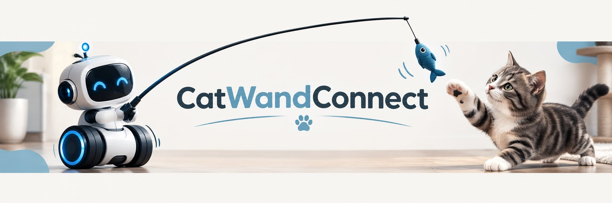
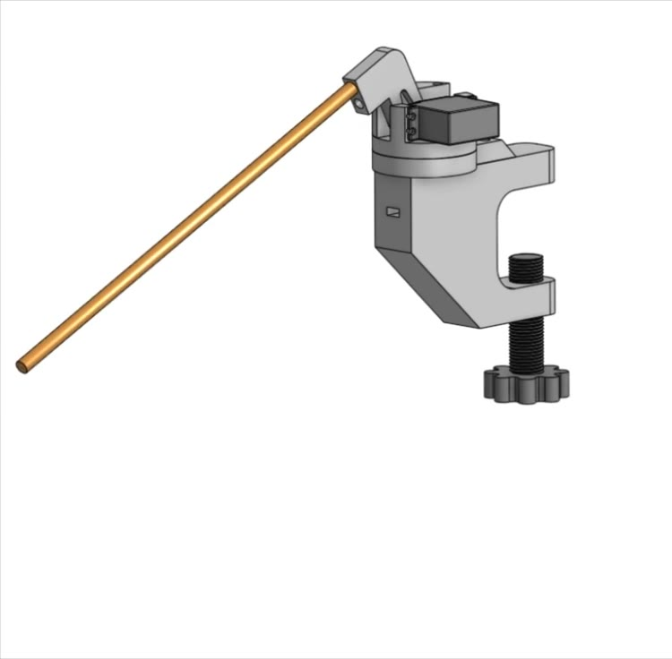
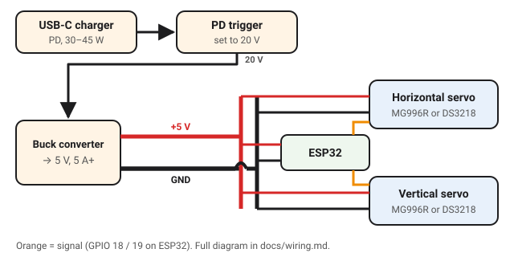

<h1 align="center">
  
</h1>

<a href="README.md">English</a> · <b>Français</b>

**Un robot open-hardware qui joue avec ton chat.** Un ESP32 agite une canne à pêche pour chat grâce à deux servos. Tu le pilotes depuis ton téléphone, sur une page web servie par le robot lui-même : pas d'appli, pas de cloud, pas de compte. Home Assistant est facultatif.

Tout est libre et ouvert : les pièces à imprimer, le firmware et la documentation.

  
   
  
  
  
  

> **État : V1 stable.** [v0.1.0](https://github.com/vistorx/CatWandConnect/releases/tag/v0.1.0), la première version stable, a passé toute la [checklist de recette](docs/acceptance-checklist.fr.md) sur un ESP32 classique. Les versions pour ESP32-S3 et ESP32-C3 sont testées automatiquement, mais pas encore sur du vrai matériel.

## Ce que c'est

- **Joue depuis ton téléphone.** Un joystick et un curseur de vitesse dans n'importe quel navigateur sur ton Wi-Fi, sans appli à installer.
- **Sûr par conception.** Des limites de course qu'il ne dépasse jamais, un bouton Ranger que rien ne peut interrompre, des mouvements doux, et un arrêt dès que ton téléphone se déconnecte.
- **Facile à installer.** Installe-le depuis le navigateur, saisis ton Wi-Fi (ou passe cette étape et utilise le hotspot du robot), puis laisse l'assistant de calibration adapter le robot à ton montage.
- **À toi de l'adapter.** Tes broches et tes servos, le nom de ton robot, l'anglais ou le français, un code PIN facultatif et des mises à jour par Wi-Fi.
- **Home Assistant si tu veux**, via MQTT, et une API ouverte pour tout le reste.

**Spécifications :** [toutes les fonctionnalités en détail](docs/features.fr.md) · [spec V1](https://github.com/vistorx/CatWandConnect/issues/1) · [spec Support](https://github.com/vistorx/CatWandConnect/issues/47) · [prévu pour plus tard](https://github.com/vistorx/CatWandConnect/issues?q=is%3Aopen+label%3Afuture) · [décisions de conception](docs/adr/) · [glossaire](CONTEXT.md) (en anglais)

## En images

   
  <em>▶ <a href="media/video/mk2-presentation.mp4">Regarde la présentation de 50 secondes</a> : imprime-le, assemble-le, ajoute le jouet préféré de ton chat, joue.</em>

*Des photos du vrai robot arrivent bientôt.*

## Fabrique le tien

Trois parties : installer le firmware, câbler l'électronique, imprimer et assembler le mécanisme. L'ordre n'a pas d'importance ; le firmware peut aller d'abord sur une carte nue.

### 1. Firmware

Le firmware s'installe depuis ton navigateur, sans rien télécharger : ouvre le flasher web dans Chrome ou Edge, branche la carte en USB et appuie sur **Connecter et installer**. La bonne version pour ta puce est choisie pour toi. Les mises à jour suivantes passent par le Wi-Fi, depuis la page Réglages du robot.

**[Ouvrir le flasher web →](https://vistorx.github.io/CatWandConnect/flasher/)** · [Installation et premier démarrage](docs/install.fr.md) · [Canaux de publication](docs/releasing.md#channels) (en anglais)

### 2. Électronique

Une seule alimentation 5 V alimente les deux servos et la carte ; la carte envoie seulement les signaux aux servos. Aucune soudure n'est nécessaire.

| Qté | Pièce |
|-----|-------|
| 1 | Carte de développement ESP32, ESP32-S3 ou ESP32-C3 (pas d'ESP8266, voir l'[ADR 0008](docs/adr/0008-no-esp8266-support.md)) |
| 2 | Servos MG996R |
| 1 | Alimentation 5 V, 3 A ou plus |
| | Bornier ou connecteurs type Wago, fils, un condensateur de 470–1000 µF en option |

**[Guide électronique →](docs/electronics.fr.md)** : schéma complet, broches par puce, règles d'alimentation.

### 3. Matériel

Le mécanisme est imprimé en 3D : six pièces, toutes dans [`stls/mk2/`](stls/mk2/) ou sur un seul plateau [`.3mf`](stls/mk2/catwandconnect-mk2.3mf). Pas d'imprimante ? N'importe quel service d'impression ou fablab peut les imprimer. Ajoute un roulement de skateboard, des billes en acier, quelques vis M3 et une canne à pêche pour chat.

| Qté | Pièce |
|-----|-------|
| 6 | Pièces imprimées (bras, roulement, pince, vis, plateau rotor, plateau supérieur) |
| 1 | Roulement de skateboard 608 |
| 16–24 | Billes en acier de 4 mm |
| 15 | Vis M3, de 8 à 30 mm |
| 1 | Canne à pêche pour chat |

**[Pièces et réglages d'impression →](docs/hardware.fr.md)** · **[Guide d'assemblage →](docs/assembly.fr.md)** (bientôt)

## Documentation

**Fabriquer et utiliser**

| Doc | Pour |
|-----|------|
| [Installation et premier démarrage](docs/install.fr.md) | Flasher depuis le navigateur, Wi-Fi, calibration, mises à jour |
| [Électronique](docs/electronics.fr.md) | Composants, schéma de câblage, alimentation, broches par défaut selon la puce |
| [Matériel](docs/hardware.fr.md) | Pièces imprimées, réglages d'impression, pièces mécaniques du Mk2 |
| [Guide d'assemblage](docs/assembly.fr.md) | Monter le Mk2 (bientôt) |
| [Fonctionnalités](docs/features.fr.md) | Tout ce que fait le robot, en détail |
| [Home Assistant](docs/home-assistant.fr.md) | Connecter le robot via MQTT |
| [Dépannage](docs/troubleshooting.fr.md) | Installation, Wi-Fi, mouvements, mises à jour, code PIN |

**Développer et contribuer**

| Doc | Pour |
|-----|------|
| [Bien démarrer](docs/getting-started.fr.md) | Outils, compilation, tests, simulateur et organisation du code |
| [API du robot](docs/api.fr.md) | API HTTP, WebSocket et MQTT, pour les scripts et les intégrations |
| [Checklist de recette](docs/acceptance-checklist.fr.md) | Ce qu'il faut vérifier sur le vrai robot avant chaque version |
| [Publier une version](docs/releasing.md) | Canaux de publication, publier une version et le flasher web (en anglais) |
| [Glossaire](CONTEXT.md) · [Décisions](docs/adr/) | Le vocabulaire du projet, et pourquoi les choses sont comme elles sont (en anglais) |
| [Médias](media/README.md) | Logo, bannières, photos et captures d'écran, et comment en ajouter (en anglais) |
| [Serveur Discord](docs/discord.fr.md) | L'organisation du serveur communautaire, pour les mainteneurs |
| [AGENTS.md](AGENTS.md) | Instructions pour les agents de code IA (en anglais) |

## Obtenir de l'aide

- **Questions, aide au montage, montrer ton robot :** le [Discord CatWandConnect](https://discord.gg/Rbqge3v9dk). Pas besoin de compte GitHub ; le français, l'anglais et d'autres langues sont les bienvenus.
- **Un bug ?** [Ouvre une issue](https://github.com/vistorx/CatWandConnect/issues/new/choose), ou poste-le dans `#support` sur Discord.
- **Un problème de sécurité ?** Signale-le [en privé](SECURITY.md), jamais en public.

CatWandConnect est maintenu sur du temps libre, sans délai de réponse garanti. Voir [Obtenir de l'aide](SUPPORT.fr.md) pour savoir quoi fournir.

## Contribuer et soutenir le projet

Les issues et les pull requests sont les bienvenues : commence par [Bien démarrer](docs/getting-started.fr.md). On peut travailler sur l'interface sans matériel, grâce au simulateur `firmware/tools/dev_server.mjs`.

CatWandConnect est gratuit. Si ton chat l'adore, tu peux soutenir le projet via [GitHub Sponsors](https://github.com/sponsors/vistorx). Des kits prêts à monter suivront peut-être.

## Licence

| | |
|---|---|
| Firmware | [GPL-3.0-or-later](LICENSES/GPL-3.0-or-later.txt) |
| Plans du matériel | [CERN-OHL-S-2.0](LICENSES/CERN-OHL-S-2.0.txt) |
| Documentation | [CC BY-SA 4.0](LICENSES/CC-BY-SA-4.0.txt) |

Tu peux fabriquer, modifier et vendre ta propre version. Voir [LICENSE.md](LICENSE.md). Le nom « CatWandConnect » est réservé au projet officiel et à ses kits ; voir la [politique de marque](TRADEMARK.md).
