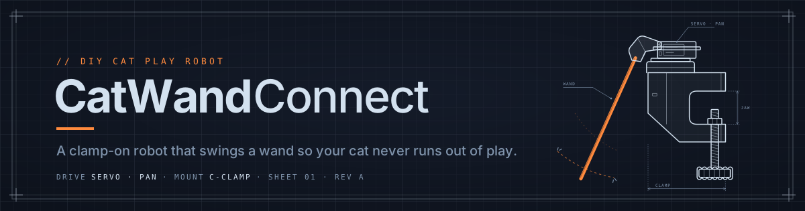
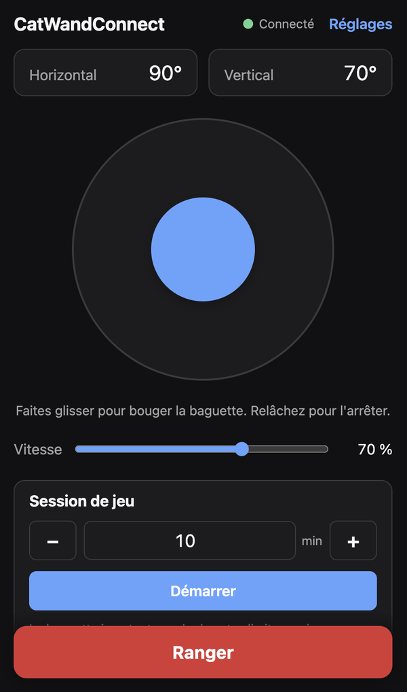
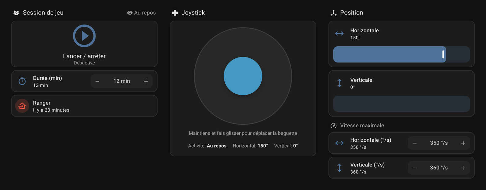
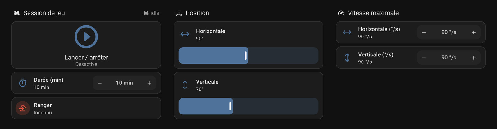
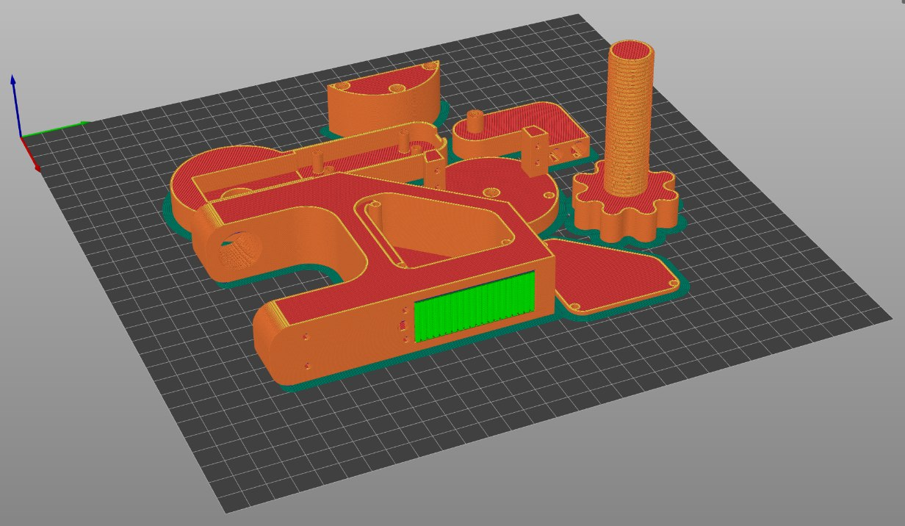

<h1 align="center">
  
</h1>

<b>English</b> · <a href="README.fr.md">Français</a>

**An open-hardware robot that plays with your cat.** An ESP32 swings a toy wand on two servos, and you drive it from your phone through a web page served by the robot itself: no app, no cloud, no account. Home Assistant is optional, and everything is open: the printable parts, the firmware and the docs.

<!-- github-only -->
> [!TIP]
> These guides are easier to read on the **[CatWandConnect website →](https://vistorx.github.io/CatWandConnect/)** (also [in French](https://vistorx.github.io/CatWandConnect/fr/)).
<!-- /github-only -->

  
  

  
  
  
  

## See it

<table>
  <tr>
    <td width="34%" valign="top">

https://github.com/user-attachments/assets/914092e7-1f09-4832-85f9-01eeb9a11499

<em>CatWandConnect in 50 seconds: print it, assemble it, add your cat's favourite toy, play.</em>

</td>
    <td width="22%" align="center" valign="top"> <em>Play from your phone</em></td>
    <td width="44%" align="center" valign="top"> <em>Home Assistant, Native integration</em>   <em>Home Assistant, MQTT connection</em></td>
  </tr>
</table>

<!-- gallery: photo of the assembled robot -->
<!-- gallery: a cat playing with the robot -->
<!-- gallery: the electronics inside the technical cavity -->

## What it is

- **Play from your phone.** A joystick and a speed slider in any browser on your Wi-Fi, with no app to install.
- **Play sessions.** Pick a duration and tap Start: the wand plays with your cat on its own, within your limits, then Stows.
- **Safe by design.** Travel limits it never exceeds, a Stow button nothing can interrupt, smooth motion, and a stop as soon as your phone disconnects.
- **Easy to set up.** Install from the browser, enter your Wi-Fi (or skip it and use the robot's hotspot), and let the Calibration wizard fit the robot to your build.
- **Yours to adapt.** Your pins and servos, your robot's name, English or French, an optional PIN, and updates over Wi-Fi.
- **Home Assistant if you want it**, through its Native integration or MQTT, and an open API for everything else.

**[All features →](docs/features.md)**

## Build your own

To build it you will print the parts, wire the electronics, install the software, assemble the robot and, if you like, connect it to Home Assistant.

### 1. Print the parts

Seven parts, in PETG, ABS or PLA. Only the clamp needs supports. No printer? Any print service or maker space can print them.

**[Detailed guide →](docs/print.md)** · **[Parts list →](docs/print.md#what-you-need)**

### 2. Wire the electronics

<!-- photo: the wired electronics on the table -->

A USB-C charger powers everything through two small boards that turn it into 5 V for the two servos and the ESP32. It needs a little soldering.

**[Detailed guide →](docs/wiring.md)** · **[Parts list →](docs/wiring.md#what-you-need)**

### 3. Install the software

  

Plug the board into a computer and install the firmware from Chrome or Edge, with nothing to download. Later updates go over Wi-Fi.

**[Detailed guide →](docs/install.md)** · **[Parts list →](docs/bom.md)**

### 4. Assemble the robot

<!-- photo or video: the assembled robot -->
Photos and videos of the assembly are coming.

The servos, the electronics and a skateboard bearing go into the printed parts, with a few M3 screws. The robot powers the servos to set their position as you go.

**[Detailed guide →](docs/assembly.md)** · **[Parts list →](docs/assembly.md#what-you-need)**

### 5. Optional: connect to Home Assistant

Add the robot to Home Assistant through the Native integration (HACS) or MQTT, with a ready-made dashboard for each.

**[Detailed guide →](docs/home-assistant.md)** · **[Parts list →](docs/home-assistant.md#what-you-need)**

## Documentation

- [1. Print the parts](docs/print.md)
- [2. Wire the electronics](docs/wiring.md)
- [3. Install the software](docs/install.md)
- [4. Assemble the robot](docs/assembly.md)
- [5. Set up Home Assistant](docs/home-assistant.md) (optional)
- [Full parts list](docs/bom.md)
- [Features](docs/features.md)
- [Troubleshooting](docs/troubleshooting.md)
- [What's new](CHANGELOG.md)
- [Getting help](SUPPORT.md) · [Discord](https://discord.gg/Rbqge3v9dk)

<b>Contributing</b>

Issues and pull requests are welcome: start with [Getting started](docs/getting-started.md). The interface can be worked on without hardware, thanks to the simulator in `firmware/tools/dev_server.mjs`.

- [Getting started](docs/getting-started.md): tools, building, tests, the simulator and the code layout
- [Device API](docs/api.md): HTTP, WebSocket and MQTT API, for scripts and integrations
- [Acceptance checklist](docs/acceptance-checklist.md): what to check on the real robot before each release
- [Releasing](docs/releasing.md): release channels, publishing a version and the web flasher
- [Glossary](CONTEXT.md) · [Design decisions](docs/adr/): the project's words, and why things are the way they are
- [V1 spec](https://github.com/vistorx/CatWandConnect/issues/1) · [Support spec](https://github.com/vistorx/CatWandConnect/issues/47) · [Planned for later](https://github.com/vistorx/CatWandConnect/issues?q=is%3Aopen+label%3Afuture)
- [Media](media/README.md): logo, banners, photos and screenshots, and how to add them
- [Discord server](docs/discord.md): how the community server is organised, for maintainers
- [AGENTS.md](AGENTS.md): instructions for AI coding agents

## Get help

- **Questions, build help, show your robot:** the [CatWandConnect Discord](https://discord.gg/Rbqge3v9dk). No GitHub account needed; English, French and other languages welcome.
- **Found a bug?** [Open an issue](https://github.com/vistorx/CatWandConnect/issues/new/choose), or post it in `#support` on Discord.
- **Security problem?** Report it [privately](SECURITY.md), never in public.

CatWandConnect is free and maintained in spare time, with no guaranteed response time; see [Getting help](SUPPORT.md) for what to include. If your cat enjoys it, you can support it through [GitHub Sponsors](https://github.com/sponsors/vistorx). Ready-to-assemble kits may follow later.

## Licence

| | |
|---|---|
| Firmware | [GPL-3.0-or-later](LICENSES/GPL-3.0-or-later.txt) |
| Hardware designs | [CERN-OHL-S-2.0](LICENSES/CERN-OHL-S-2.0.txt) |
| Documentation | [CC BY-SA 4.0](LICENSES/CC-BY-SA-4.0.txt) |

You may build, modify and sell your own version. See [LICENSE.md](LICENSE.md). The name "CatWandConnect" is reserved for the official project and kits; see the [trademark policy](TRADEMARK.md).
