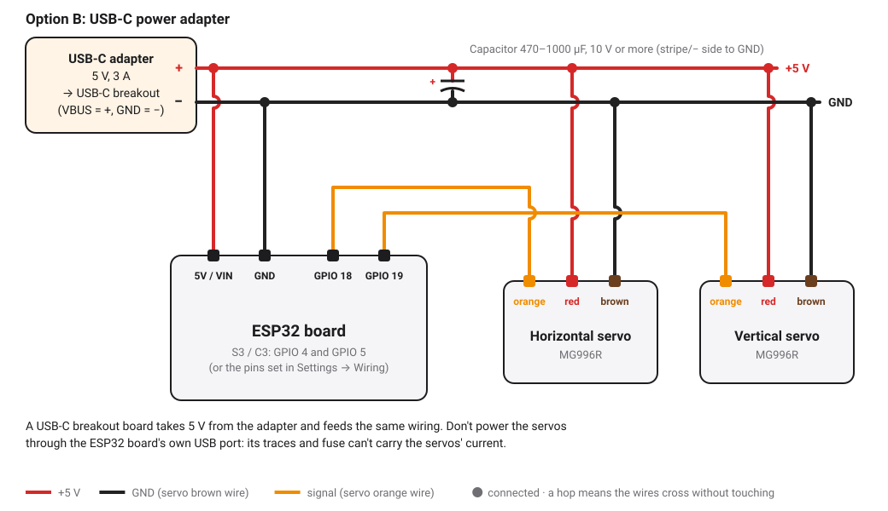

# Electronics

How to wire the two servos and the power supply to the board. The firmware drives the servos with 50 Hz PWM pulses; the board only sends the signals and never powers the servos.

## Supported boards

Any ESP32, ESP32-S3 or ESP32-C3 development board. ESP8266 boards are not supported ([ADR 0008](adr/0008-no-esp8266-support.md)).

## Default pins

| Chip | Horizontal servo | Vertical servo |
|------|------------------|----------------|
| ESP32 | GPIO 18 | GPIO 19 |
| ESP32-S3 | GPIO 4 | GPIO 5 |
| ESP32-C3 | GPIO 4 | GPIO 5 |

On the S3 and C3, GPIO 18 and 19 carry USB, so the defaults differ. To wire differently, choose the pins in **Settings → Wiring**; the robot restarts to apply them. The list only offers pins that are safe on your chip.

## Wiring

The robot runs from a single 5 V source that feeds three things: the two servos and the board. Two options, wired the same way past the source.

Each MG996R has three wires: **orange** (signal), **red** (+5 V) and **brown** (ground).

| Wire | Connect to |
|------|------------|
| Servo red | +5 V |
| Servo brown | GND |
| Horizontal servo orange | GPIO 18 (S3/C3: GPIO 4) |
| Vertical servo orange | GPIO 19 (S3/C3: GPIO 5) |
| Board 5V / VIN pin | +5 V |
| Board GND pin | GND |

Use a small terminal block, a Wago-style connector or a perfboard as the +5 V and GND "rails" that everything plugs into.

### Option A: 5 V power supply (recommended)

- A 5 V adapter of **3 A or more** (4 A gives comfortable headroom), with a DC-jack-to-screw-terminal adapter.
- The board takes its power from its **5V/VIN** pin. Its USB port can stay unplugged; plug it in only to flash or read logs.
- Most dev boards have a diode that keeps the external 5 V from flowing back into your computer over USB, but not all. If you're not sure about yours, unplug the 5 V supply (or the board's 5V wire) before connecting USB to a computer.

### Option B: USB-C power adapter

- A USB-C phone charger that delivers **5 V at 3 A**, and a **USB-C breakout board** (a "USB-C power" or "PD trigger" module set to 5 V). The breakout's VBUS is +5 V and its GND is ground.
- Pick a breakout with the two **5.1 kΩ CC resistors**. Most "USB-C power" breakouts have them; without them, a USB-C charger gives no power.
- **Don't power the servos through the ESP32 board's own USB port.** Its traces, fuse and diode are made for a few hundred milliamps, and two MG996R draw far more when they start or stall. The board's USB port stays free for flashing.

## Rules

- **Common ground.** The board's GND must be connected to the supply's −, or the servos will jitter or ignore the signal.
- **Never power the servos from the board.** Not from its 3.3 V pin, and not from its 5 V pin when it runs on USB. An MG996R can draw over 1 A when it stalls.
- **Size the supply.** Allow 3 A or more for two MG996R. A weak supply resets the board when both servos start together, often seen as the robot rebooting when the wand moves.
- **Thick power wires.** Keep the 5 V and ground wires to the servos short and reasonably thick.
- **Capacitor.** If the board resets or motion stutters, add a capacitor (470–1000 µF, 10 V or more) across the servo supply, close to the servos.

## Servo pulse range

The defaults come from the proof of concept: 400–2200 µs for the Horizontal servo and 600–2400 µs for the Vertical one, mapped to 0°–180°. If your servos don't reach their full travel, or buzz at an end, adjust the pulse range in **Settings → Wiring**. The same section reverses an axis whose direction is mirrored. Either change resets Calibration, so run it again afterwards.
