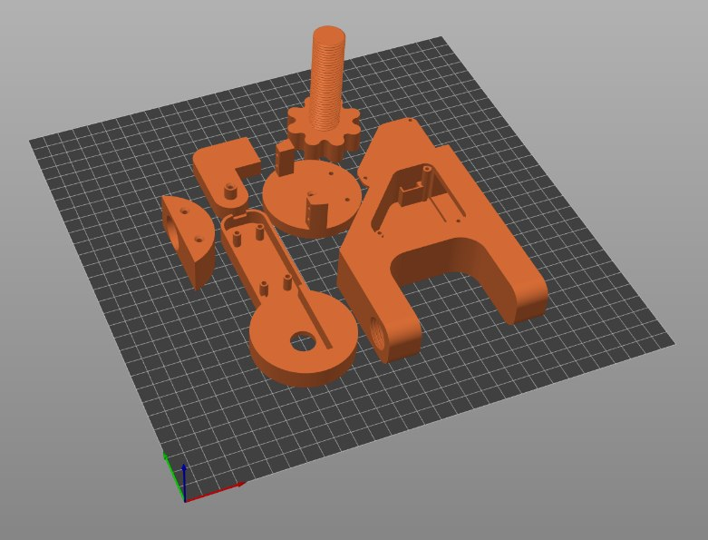

# Imprimer les pièces

https://github.com/user-attachments/assets/914092e7-1f09-4832-85f9-01eeb9a11499

<em>La présentation du Mk2, le mécanisme précédent (50 s, animation 3D).</em>

Les sept pièces imprimées du Mk3, le mécanisme actuel, et comment les imprimer. Ensuite : [les assembler](assembly.fr.md).

## Les pièces

Le **Mk3** est le mécanisme actuel. Il est autonome : la carte et les cartes d'alimentation tiennent dans le robot, dans la cavité technique de la pince fermée par une porte imprimée, et un seul connecteur USB-C l'alimente. Tous les fichiers sont dans [`stls/mk3/`](../stls/mk3/), et [`catwandconnect-mk3.3mf`](../stls/mk3/catwandconnect-mk3.3mf) contient le plateau complet.

| Pièce | Fichier |
|-------|---------|
| Bras | [`catwandconnect-mk3-arm.stl`](../stls/mk3/catwandconnect-mk3-arm.stl) |
| Support de roulement | [`catwandconnect-mk3-bearing_holder.stl`](../stls/mk3/catwandconnect-mk3-bearing_holder.stl) |
| Pince | [`catwandconnect-mk3-clamp.stl`](../stls/mk3/catwandconnect-mk3-clamp.stl) |
| Porte | [`catwandconnect-mk3-door.stl`](../stls/mk3/catwandconnect-mk3-door.stl) |
| Vis | [`catwandconnect-mk3-screw.stl`](../stls/mk3/catwandconnect-mk3-screw.stl) |
| Plateau rotor | [`catwandconnect-mk3-rotor_plate.stl`](../stls/mk3/catwandconnect-mk3-rotor_plate.stl) |
| Plateau supérieur | [`catwandconnect-mk3-top_plate.stl`](../stls/mk3/catwandconnect-mk3-top_plate.stl) |

**Ce qui change par rapport au Mk2 :** l'électronique passe à l'intérieur du robot, derrière la nouvelle porte, et le robot n'a besoin que d'un seul câble USB-C.

### Mécanisme précédent : Mk2

Le Mk2, renforcé par un roulement de skateboard 608 et un chemin de billes en acier de 4 mm, laisse l'électronique à l'extérieur du robot. Choisis-le si tu préfères garder la carte et les cartes d'alimentation dehors. Ses six pièces sont dans [`stls/mk2/`](../stls/mk2/), et [`catwandconnect-mk2.3mf`](../stls/mk2/catwandconnect-mk2.3mf) contient son plateau complet.

## Conseils d'impression

> Des points de départ, pas encore vérifiés sur le montage de référence. Partage les réglages qui marchent pour toi sur [Discord](https://discord.gg/Rbqge3v9dk) et ils seront ajoutés ici.

- **Matière :** le PLA convient pour un robot qui reste à l'intérieur ; le PETG est plus résistant si le chat attaque le bras.
- **Supports :** aucun, sauf pour la pince. Imprime toutes les autres pièces, porte comprise, sans supports. La pince a besoin de supports sous ses surfaces horizontales uniquement : dans PrusaSlicer, active les supports avec un **seuil de surplomb de 5°** pour qu'ils ne remplissent pas ses pentes ni ses trous.
- **Solidité :** 3 parois ou plus et 20 à 30 % de remplissage. Le bras, la pince et les pièces qui tiennent les servos encaissent les efforts.
- **Chemin de billes :** imprime-le à plat avec une première couche fine, et retire les fils et la patte d'éléphant pour que les billes roulent librement.
- **Ajustement :** si le roulement ou un servo ne rentre pas, ponce la pièce plutôt que de forcer.
- Le [`.3mf`](../stls/mk3/catwandconnect-mk3.3mf) contient le plateau complet en un seul fichier.

Une pièce imprimée casse ? Réimprime-la : c'est tout l'intérêt d'un design ouvert.

Ensuite : [Assembler le mécanisme](assembly.fr.md).
