# Câbler l'électronique

Ce guide te permet de câbler la carte, les deux servos et la chaîne d'alimentation USB-C, et de les tester sur la table, prêts pour le logiciel.

Le firmware pilote les servos avec des impulsions PWM à 50 Hz ; la carte envoie seulement les signaux et n'alimente jamais les servos.

<!-- github-only -->

<!-- /github-only -->
<iframe style="width:100%;aspect-ratio:16/9;border:0" src="https://www.youtube-nocookie.com/embed/qAPqGfsNPbk" title="CatWandConnect tutorial - Wiring" allow="accelerometer; clipboard-write; encrypted-media; gyroscope; picture-in-picture; web-share" referrerpolicy="strict-origin-when-cross-origin" allowfullscreen></iframe>

La vidéo montre toutes les étapes de [Monter pas à pas](#monter-pas-à-pas) ([voir sur YouTube](https://youtu.be/qAPqGfsNPbk)).

## Ce qu'il te faut

| Qté | Pièce | Remarques |
|-----|-------|-----------|
| 1 | Carte de développement ESP32, ESP32-S3 ou ESP32-C3 | N'importe quelle carte avec USB, à partir d'environ 3 €. L'USB-C est pratique. |
| 2 | Servos MG996R (parfois vendus sous le nom SG996R) | Servos de taille standard à pignons métalliques. Version plus robuste : [DS3218](#servos-plus-robustes--ds3218). |
| 1 | Chargeur USB-C PD, 30 W minimum, 45 W conseillé | Doit proposer le 20 V (USB Power Delivery). Voir [Choisir le chargeur](#choisir-le-chargeur). |
| 1 | Carte de déclenchement USB-C PD (*PD trigger*), réglée sur 20 V | Demande 20 V au chargeur et les transmet. |
| 1 | Convertisseur abaisseur (*buck*), sortie 5 V, 5 A ou plus | Transforme le 20 V en 5 V pour les servos et la carte. Un 8 A donne de la marge. |
| 1 | Condensateur, 470–1000 µF, 10 V ou plus | Facultatif, contre les redémarrages et les à-coups. |
| 2 | Connecteurs à levier (type Wago 221), 2 entrées (par ex. 221-412) | Les rails +5 V et GND : une entrée pour la sortie du convertisseur, l'autre pour les fils des servos et de la carte torsadés ensemble. Des connecteurs plus grands, un bornier ou une plaque à trous conviennent aussi. |
| 3 | Rallonges de servo, environ 30 cm (JR/Futaba 3 broches, le modèle standard) | Deux reçoivent les servos, une alimente la carte. Voir [Monter pas à pas](#monter-pas-à-pas). |
| 40 cm | Fil d'environ 0,5 mm² (AWG 20) et connecteurs Dupont femelles | Le fil pour l'alimentation : 2 × 5 cm (carte de déclenchement vers convertisseur) et 2 × 15 cm (convertisseur vers les connecteurs à levier dans la cavité technique), un + et un − à chaque fois. Les embouts Dupont pour les broches de la carte. |

Outils : un fer à souder et un multimètre.

Une simple alimentation 5 V de 3 A ou plus marche aussi, à la place du chargeur, de la carte de déclenchement et du convertisseur : branche-la directement sur les rails +5 V et GND.

**[Liste complète des pièces →](bom.fr.md)**

### Exemples de composants

Ce sont les composants du montage de référence. Les annonces changent avec le temps et n'importe quel composant équivalent convient. Les liens sont des exemples, ni sponsorisés ni affiliés.

| Pièce | Exemples d'annonces (AliExpress) | Ce qu'il faut chercher |
|-------|----------------------------------|------------------------|
| Servo MG996R (parfois vendu sous le nom SG996R) | [Exemple](https://fr.aliexpress.com/item/1005012099566939.html) | Taille standard, pignons métalliques, 180°. |
| Servo DS3218 (version plus robuste) | [Exemple](https://fr.aliexpress.com/item/1005010498819386.html) | La version **180°**, pignons métalliques, classe 20 kg·cm. Voir [Servos plus robustes](#servos-plus-robustes--ds3218). |
| Carte de déclenchement USB-C PD | [Exemple 1](https://www.aliexpress.com/item/1005010610660644.html), [exemple 2](https://www.aliexpress.com/item/1005005461879717.html) | Entrée USB-C, PD3.0/PD3.1 (QC3.0 en bonus), sortie au choix de 5 à 48 V, 5 A. |
| Convertisseur abaisseur | [8 A](https://www.aliexpress.com/item/1005009516551580.html), [5 A](https://www.aliexpress.com/item/1005009289437405.html) | Entrée jusqu'à 25 V, sortie au choix ou réglable (3,3/5/9/12 V), réglée sur 5 V. |

### Servos plus robustes : DS3218

Le DS3218 coûte plus cher que le MG996R, mais il est bien plus solide et a beaucoup plus de couple (classe 20 kg·cm, pignons métalliques). Il a la même taille de servo standard, il devrait donc tenir dans les mêmes supports du Mk3 (pas encore vérifié).

- Prends la version **180°**. Le DS3218 existe aussi en 270°, ce qui fausserait les angles.
- Sa plage d'impulsions est d'environ 500–2500 µs : règle-la dans **Réglages → Matériel → Câblage**, puis relance la calibration. Voir [Plage d'impulsions des servos](#plage-dimpulsions-des-servos).
- Il tire plus de courant quand il force, jusqu'à environ 2,5–3 A chacun. Avec deux DS3218, prends le convertisseur 8 A et un chargeur de 45 W.

## Cartes compatibles

N'importe quelle carte de développement ESP32, ESP32-S3 ou ESP32-C3. Les cartes ESP8266 ne sont pas compatibles ([ADR 0008](adr/0008-no-esp8266-support.md), en anglais).

## Broches par défaut

| Puce | Servo horizontal | Servo vertical |
|------|------------------|----------------|
| ESP32 | GPIO 18 | GPIO 19 |
| ESP32-S3 | GPIO 4 | GPIO 5 |
| ESP32-C3 | GPIO 4 | GPIO 5 |

Sur les S3 et C3, les GPIO 18 et 19 servent à l'USB, d'où des broches par défaut différentes. Pour câbler autrement, choisis les broches dans **Réglages → Matériel → Câblage** ; le robot redémarre pour les appliquer. La liste ne propose que les broches sans danger sur ta puce.

## Alimentation

Le robot fonctionne avec un chargeur USB-C, à travers deux petites cartes :

1. **Chargeur USB-C** → **carte de déclenchement PD**, par un câble USB-C. La carte de déclenchement demande 20 V au chargeur.
2. **Carte de déclenchement PD** → **convertisseur abaisseur** : le 20 V entre dans le convertisseur.
3. **Convertisseur abaisseur** → **rails +5 V et GND** : sa sortie 5 V alimente les deux servos et la carte.

Règle les deux cartes **avant** de brancher les servos ou la carte :

1. Règle la carte de déclenchement sur **20 V** (avec son pont de soudure, son cavalier ou son bouton, comme l'explique son annonce), branche-la au chargeur et vérifie sa sortie au multimètre : environ 20 V.
2. Branche le convertisseur, règle sa sortie sur **5 V** et vérifie-la au multimètre : environ 5 V.
3. Seulement ensuite, branche la sortie du convertisseur sur les rails +5 V et GND.

**Ne choisis jamais une tension de déclenchement supérieure à l'entrée maximale du convertisseur.** Les convertisseurs donnés en exemple acceptent jusqu'à 25 V : 20 V est le bon choix, et 28 V ou plus les détruirait.

### Choisir le chargeur

Prends un bon chargeur USB-C PD qui propose le 20 V : **30 W minimum, 45 W c'est beaucoup mieux**. Deux MG996R peuvent tirer chacun plus de 1 A quand ils forcent, et les deux cartes perdent un peu de puissance en la convertissant. 30 W suffit ; 45 W laisse de la marge pour que le chargeur ne coupe pas quand les deux servos démarrent ensemble.

## Câblage

La sortie 5 V du convertisseur abaisseur alimente les deux servos et la carte.

Chaque MG996R a trois fils : **orange** (signal), **rouge** (+5 V) et **marron** (masse).

| Fil | À brancher sur |
|-----|----------------|
| Rouge des servos | +5 V |
| Marron des servos | GND |
| Orange du servo horizontal | GPIO 18 (S3/C3 : GPIO 4) |
| Orange du servo vertical | GPIO 19 (S3/C3 : GPIO 5) |
| Broche 5V / VIN de la carte | +5 V |
| Broche GND de la carte | GND |

Utilise un petit bornier, un connecteur type Wago ou une plaque à trous comme « rails » +5 V et GND sur lesquels tout se branche.

- La sortie 5 V du convertisseur abaisseur alimente tout ; la carte prend son alimentation sur sa broche **5V/VIN**.
- Ne branche l'USB de la carte sur un ordinateur que pour flasher ou lire les logs. La plupart des cartes ont une diode qui empêche le 5 V externe de remonter vers l'ordinateur, mais pas toutes : si tu n'es pas sûr de la tienne, débranche d'abord le chargeur USB-C.

## Règles

- **Masse commune.** Le GND de la carte doit être relié au − de la sortie du convertisseur, sinon les servos tremblent ou ignorent le signal.
- **N'alimente jamais les servos par la carte.** Ni par sa broche 3,3 V, ni par sa broche 5 V quand elle est alimentée par l'USB. Un MG996R peut tirer plus de 1 A quand il force.
- **Dimensionne l'alimentation.** Prévois 5 A ou plus en 5 V pour deux MG996R : un convertisseur de 5 A ou plus, un chargeur de 30 W ou plus (ou une simple alimentation 5 V de 3 A ou plus). Une alimentation trop faible fait redémarrer la carte quand les deux servos démarrent ensemble : on voit souvent le robot redémarrer quand la baguette bouge.
- **Fils d'alimentation épais.** Garde les fils 5 V et de masse vers les servos courts et assez épais.
- **Condensateur.** Si la carte redémarre ou si les mouvements saccadent, ajoute un condensateur (470–1000 µF, 10 V ou plus) entre les rails +5 V et GND, près des servos.

## Plage d'impulsions des servos

Les valeurs par défaut viennent de la preuve de concept : 400–2200 µs pour le servo horizontal et 600–2400 µs pour le vertical, pour 0° à 180°. Si tes servos ne vont pas au bout de leur course, ou grésillent en butée, ajuste la plage d'impulsions dans **Réglages → Matériel → Câblage**. La même section inverse un axe dont le sens est à l'envers. Les deux changements effacent la calibration : relance-la ensuite.

## Monter pas à pas

La [vidéo en haut de ce guide](#câbler-lélectronique) montre toutes les étapes ci-dessous. Voici comment est câblé le montage de référence, avec des connecteurs à levier (type Wago 221) comme rails et des rallonges de servo. Il demande un peu de soudure. Tout autre montage peut suivre à la place le tableau et le schéma de [Câblage](#câblage) ci-dessus : ils valent pour tous les montages. Câble-le sur la table et teste-le d'abord ; il entre dans le robot dans [Assembler le robot](assembly.fr.md).

Laisse le chargeur débranché, sauf quand une étape dit le contraire.

### 0. Sors les composants

Pose tout sur le plan de travail : les trois rallonges de servo, les deux connecteurs à levier, les fils de 5 cm et de 15 cm, la carte, la carte de déclenchement USB-C PD, le convertisseur abaisseur, l'étain et le fer à souder.

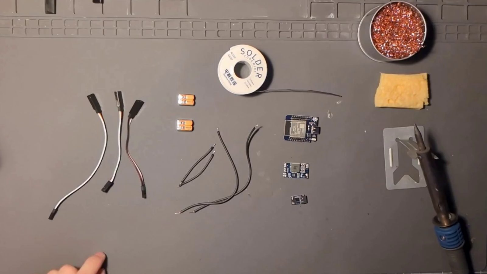

### 1. Prépare les rallonges de servo

Prends les trois rallonges de servo. Sur celles-ci, le fil de signal est blanc, le + rouge et le − noir (sur d'autres : orange, rouge et marron).

Chaque rallonge a deux bouts : une petite prise qui s'enfiche sur les broches de la carte, et une prise où se branche un servo.

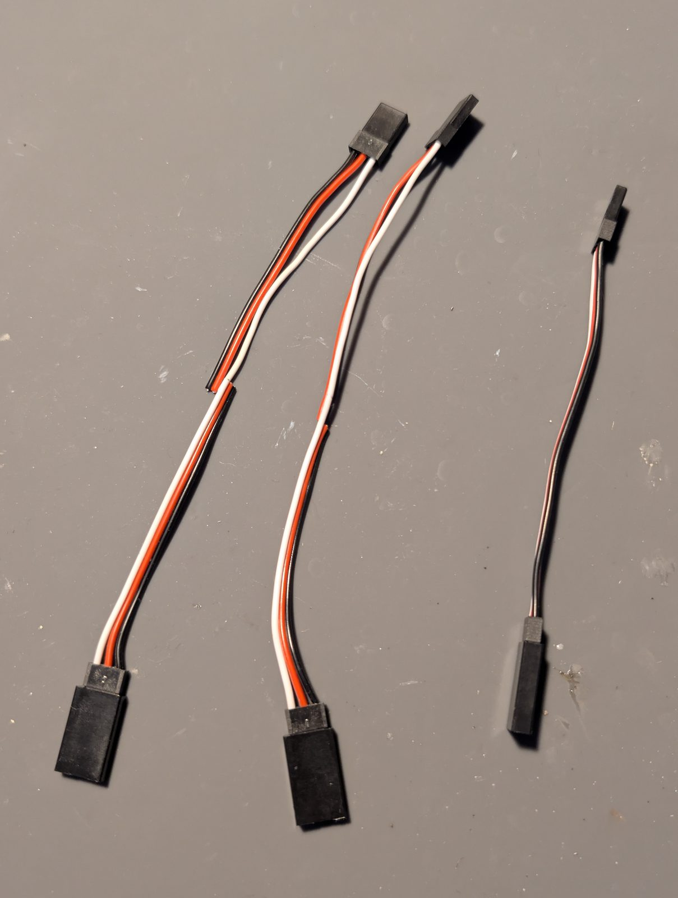

### 2. Le câble d'alimentation de la carte

La première rallonge alimente la carte. Coupe-la et garde la moitié avec la petite prise. Retire complètement son fil de signal, puis dénude le + et le − (à droite sur la photo). L'autre moitié part à la poubelle.

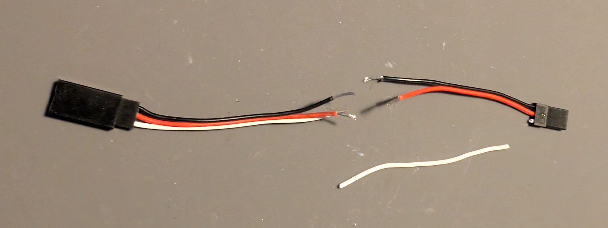

### 3. Les deux câbles des servos

Sur les deux autres rallonges, garde le fil de signal entier, d'un bout à l'autre. Coupe le + et le − près de la petite prise et garde-les du côté de la prise du servo, puis dénude leurs bouts (à gauche sur la photo). Les petits bouts de + et de − restés sur la petite prise partent à la poubelle.

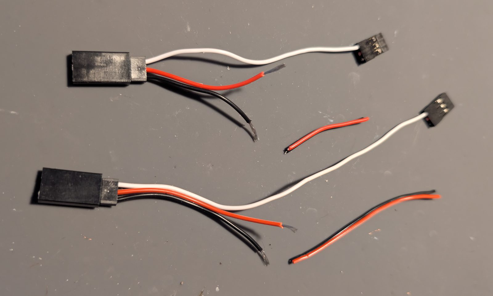

### 4–5. Rassemble les + et les −

Torsade ensemble les trois fils + (un par rallonge), puis les trois fils −. Chaque paquet devient un seul bout, prêt pour un connecteur à levier.

  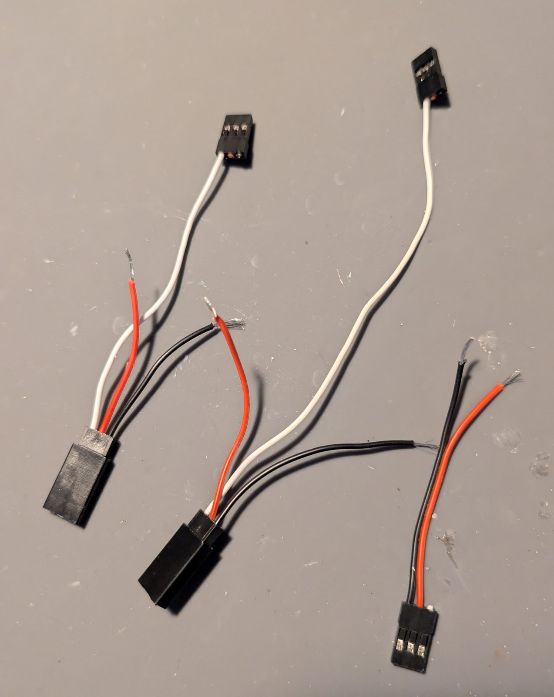
  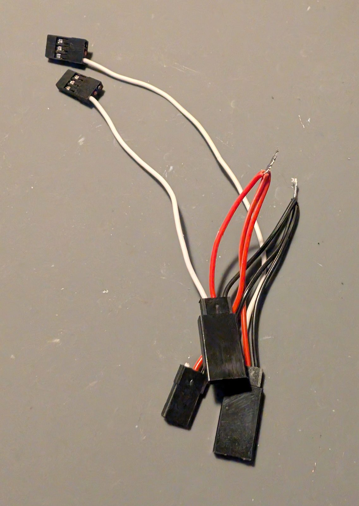

### 6. Sortie de la carte de déclenchement

Soude les deux fils de 5 cm sur la sortie de la carte de déclenchement USB-C PD, + et −. Les deux cartes sont sur le plateau supérieur : des fils courts suffisent.

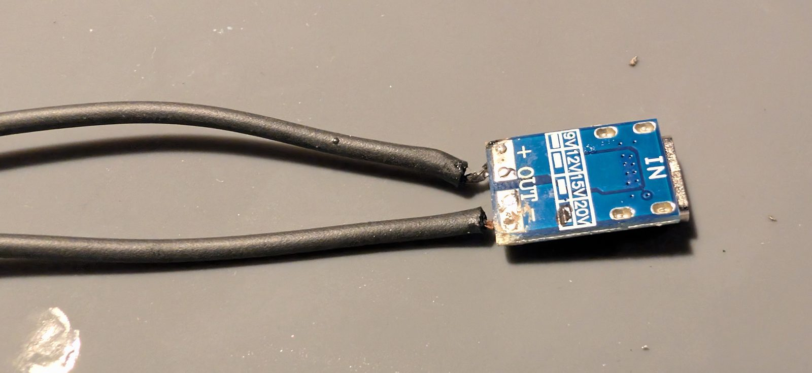

### 7. Entrée du convertisseur

Soude l'autre bout de ces deux fils sur les broches IN du convertisseur abaisseur : + sur +, − sur −.

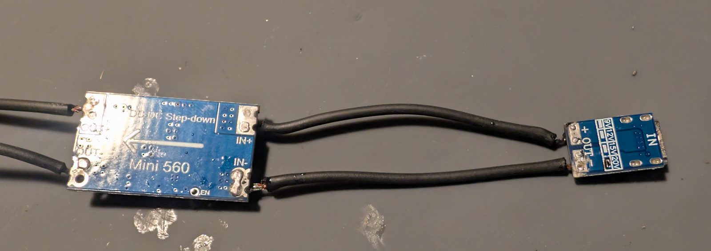

### 8. Sortie du convertisseur

Soude les deux fils de 15 cm sur les broches OUT du convertisseur, + et −. Ils passent par le trou du plateau supérieur jusque dans la cavité technique : ils doivent être assez longs pour atteindre les connecteurs à levier.

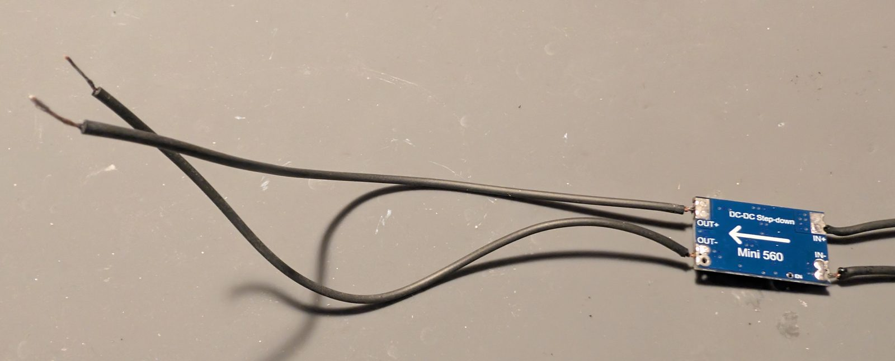

**Règle et vérifie les tensions maintenant**, avant de brancher quoi que ce soit d'autre : la carte de déclenchement sur 20 V et la sortie du convertisseur sur 5 V, vérifiées toutes les deux au multimètre, comme dans [Alimentation](#alimentation). Débranche ensuite le chargeur.

### 9. Connecteurs à levier

Mets un connecteur à levier au bout de chaque fil de 15 cm : un sur le +, un sur le −.

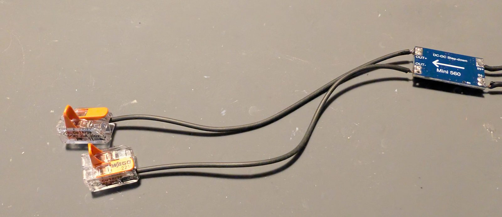

### 10. Les rails

Mets le paquet de fils + dans la seconde entrée du connecteur à levier du fil +, et le paquet de fils − dans la seconde entrée de celui du fil −. Ce sont les rails +5 V et GND. Pas le plus propre, mais ça tient.

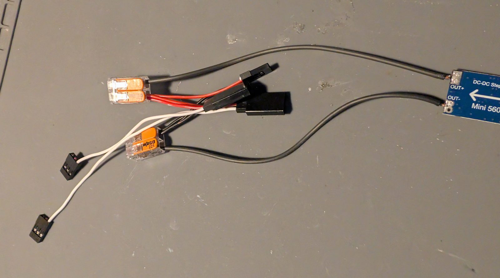

### 11–12. Alimente la carte

Enfiche le câble d'alimentation de la carte (sa petite prise, avec seulement le + et le −) sur les broches **VCC** (5V/VIN) et **GND** de la carte : le + sur VCC, le − sur GND. Sur la carte de référence (Mini D1 ESP32), VCC et GND sont côte à côte, encadrées en vert.

**Vérifie d'abord le brochage de ta carte.** Si 5V/VIN et GND ne sont pas côte à côte, utilise plutôt deux fils Dupont femelles séparés. Ne mets jamais le + sur la broche 3,3 V.

  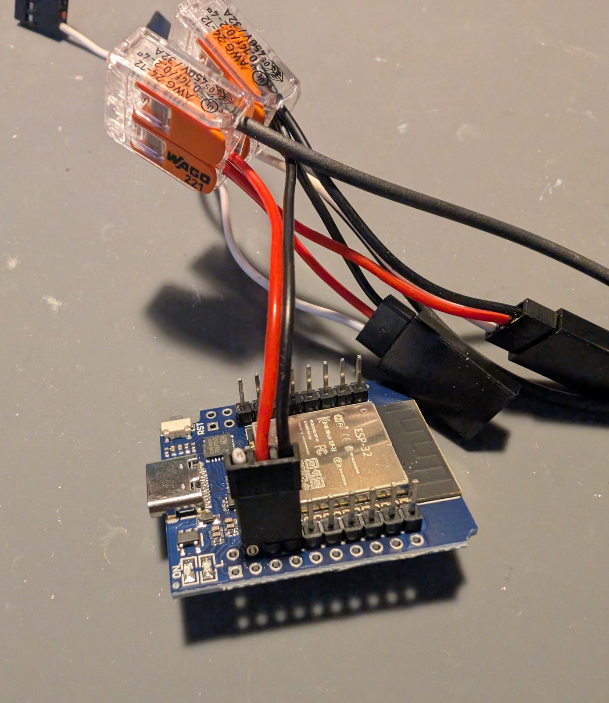
  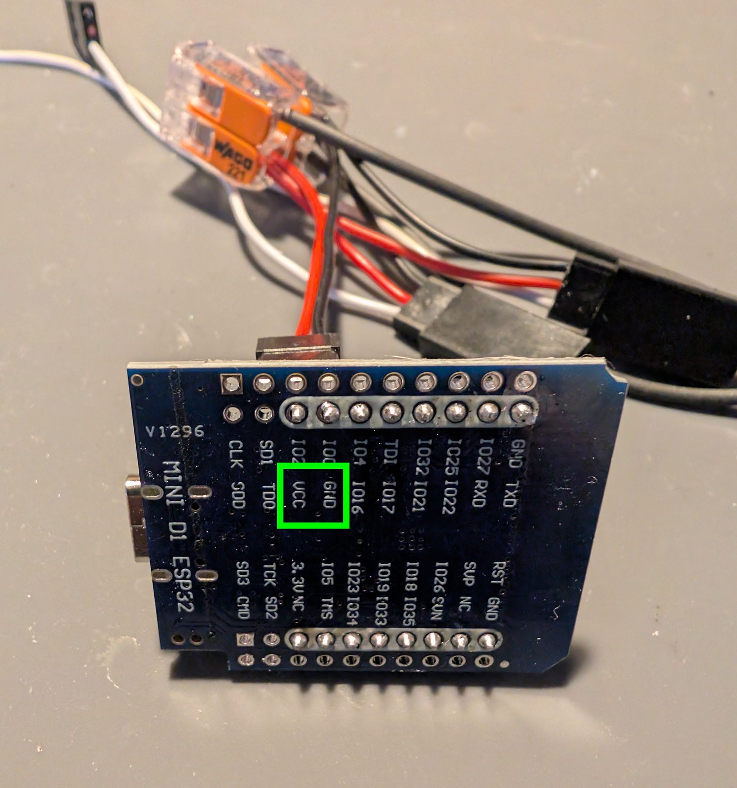

### 13–14. Fils de signal

Enfiche la petite prise de chaque câble de servo sur les broches **GPIO 18** et **GPIO 19** de la carte (S3/C3 : **GPIO 4** et **GPIO 5**). Peu importe lequel va où : c'est le servo que tu branches sur chaque câble en [assemblant le robot](assembly.fr.md) qui décide de l'axe qu'il commande, et tu peux échanger les broches plus tard dans **Réglages → Matériel → Câblage**.

  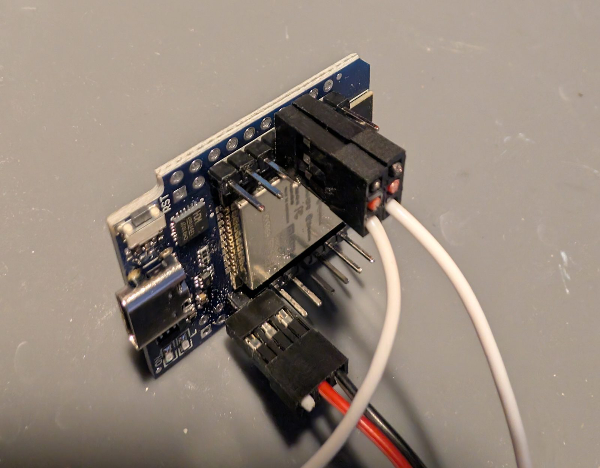
  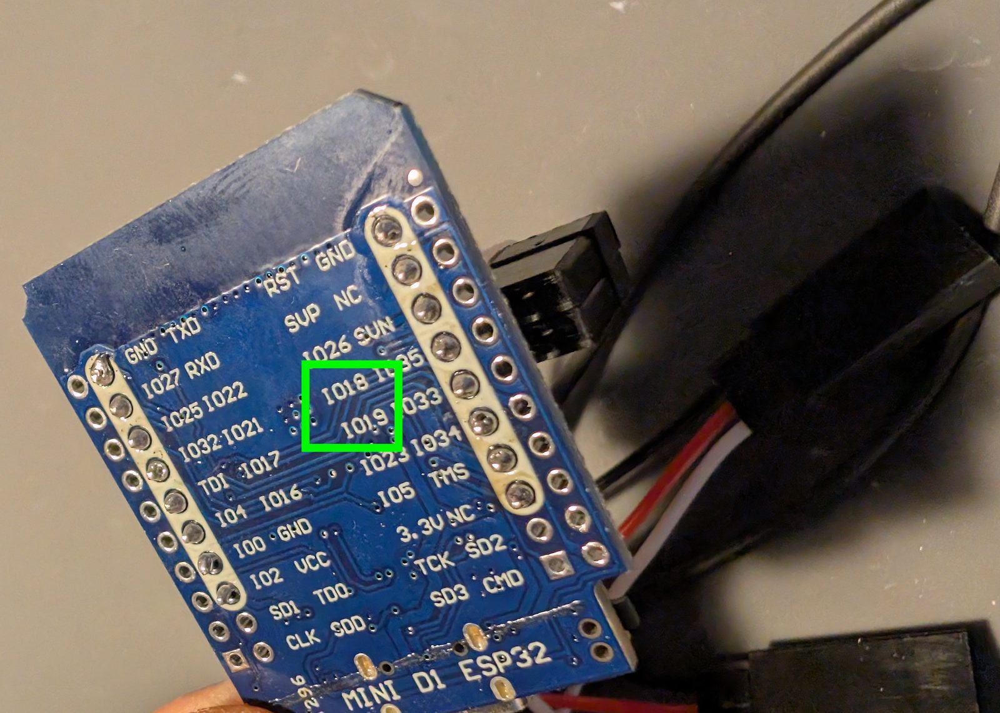

### 15. Teste l'alimentation

Branche la carte de déclenchement sur le chargeur : la LED de la carte doit s'allumer. Sinon, débranche tout de suite et vérifie les tensions et le + et le − de chaque branchement.

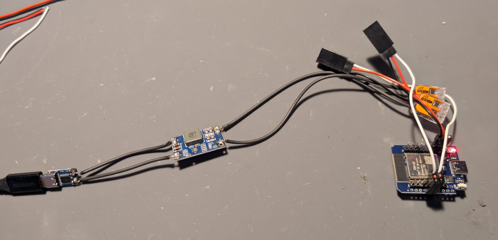

L'électronique est prête. Ensuite : [Installer le logiciel](install.fr.md), puis [Assembler le robot](assembly.fr.md).
